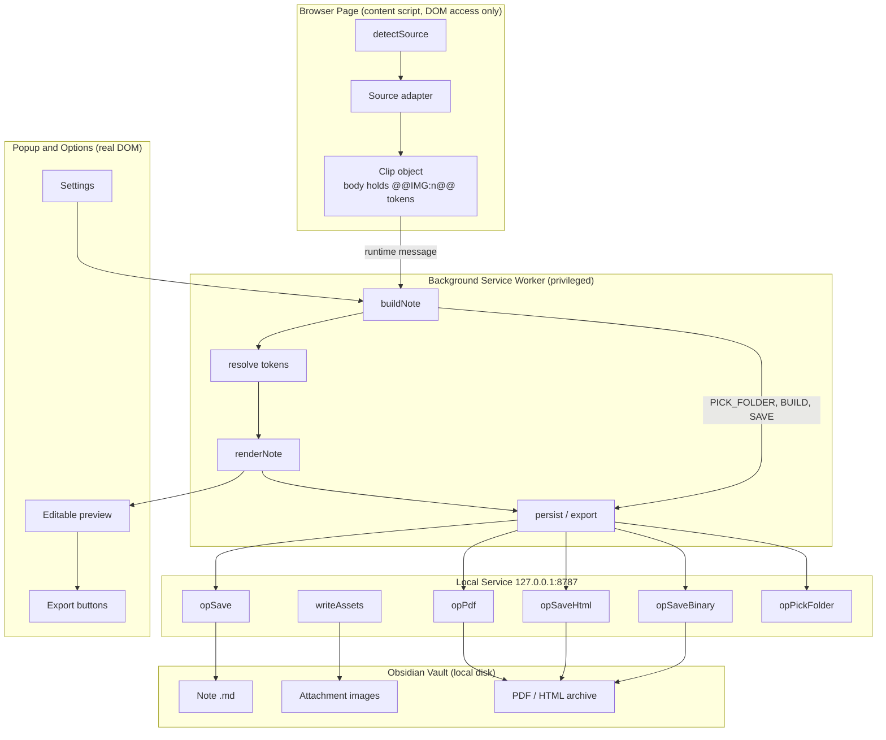
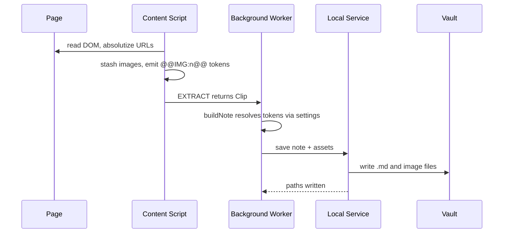
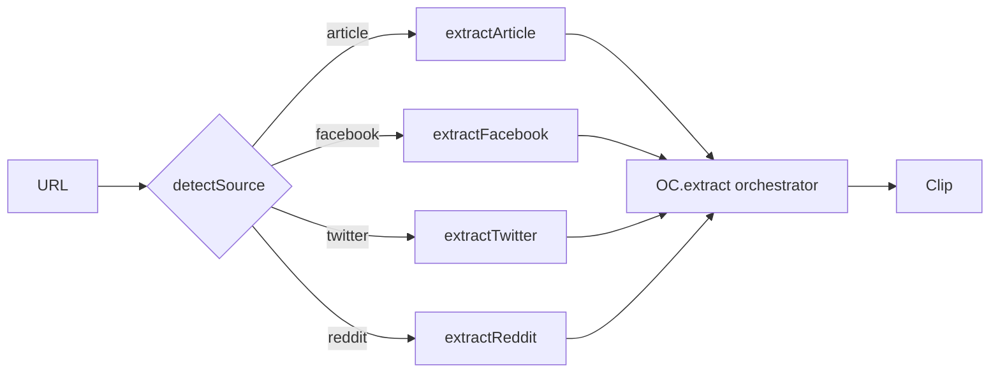
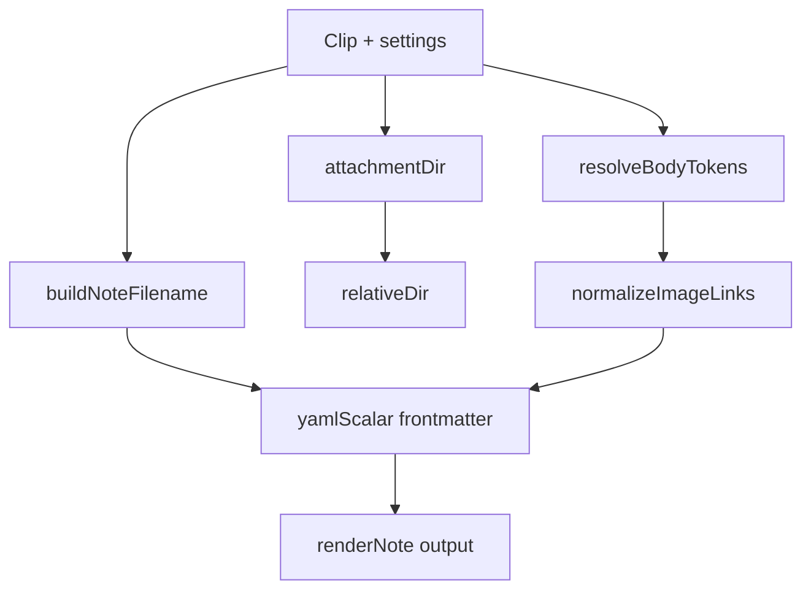
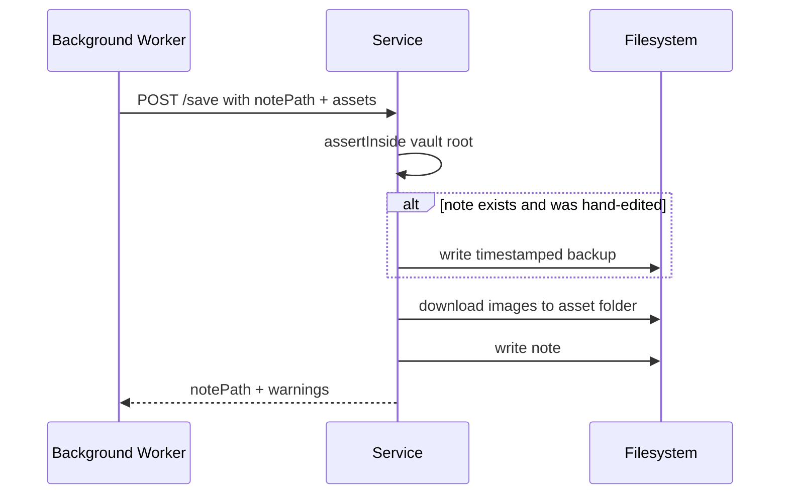
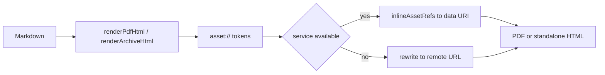
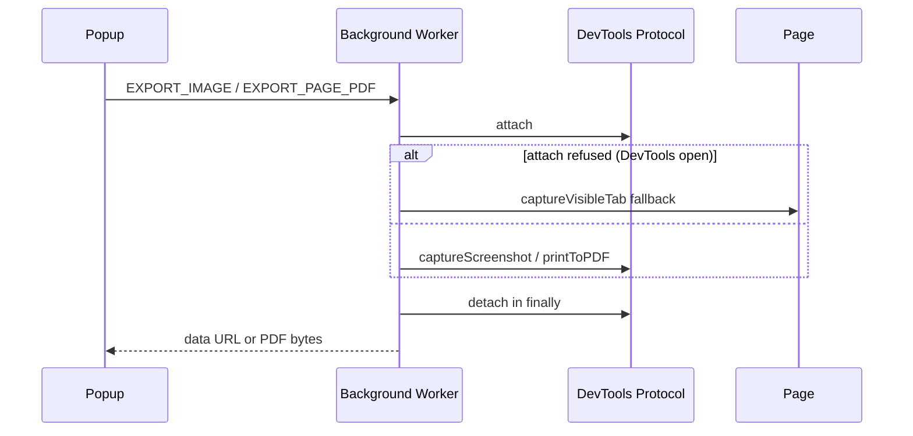
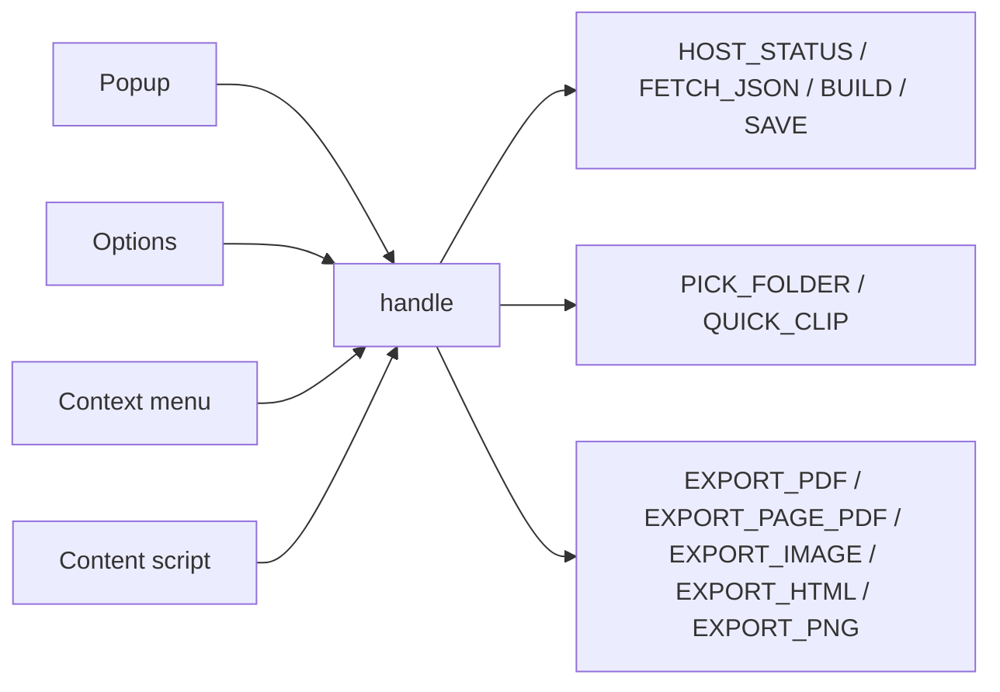
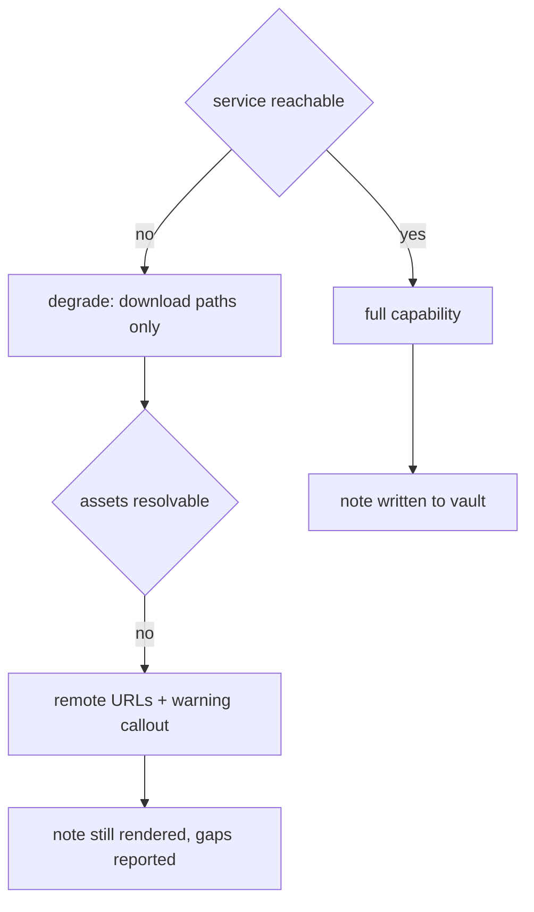

# System Architecture (`ARCHITECTURE.md`)
> **1-Line Summary:** Plain-English visual map of how Web Clipper Manager works, why each piece exists, and the step-by-step recipes for adding to it safely.

## 1. High-Level Visual System Map

## 2. Tech Stack & Why We Chose It

| Layer | Tool / Library | Plain-English Reason Why |
| --- | --- | --- |
| Host / platform | Chromium MV3 extension | It has to run where the page is, in the browser the owner already uses, with no installer. |
| Article extraction | Mozilla Readability (vendored) | Proven main-content detector; vendoring keeps it offline and satisfies MV3's no-remote-code rule. |
| HTML → Markdown | Turndown + turndown-plugin-gfm (vendored) | Reliable DOM-to-Markdown with tables and strikethrough; pure, so it can be unit-tested. |
| Markdown → HTML | marked (vendored) | Needed for the note PDF and HTML archive; small and predictable. |
| Extension logic | Plain classic scripts sharing `globalThis.OC` | MV3 content scripts cannot be ES modules and there is no bundler, so a shared namespace in a fixed load order is the honest option. |
| Local file access | Node loopback HTTP service | Service workers cannot open a folder dialog or write a file; a local HTTP service can, and it is `curl`-debuggable. |
| Note PDF | puppeteer-core driving installed Edge/Chrome | Uses the browser the user already has instead of shipping a renderer. |
| Test harness | jsdom + node test scripts | Runs the real vendored pipeline against HTML fixtures, so tests exercise shipping code. |
| Storage of settings | `chrome.storage.sync` | Survives extension reloads and follows the browser profile without a config file. |

## 3. Core Subsystems & Engineering Tricks

### [SUBSYSTEM: Clip-Model-And-Token-Pipeline] | Aliases: @@IMG tokens, one object, adapter, placeholder, image resolution
> **1-Line Summary:** Adapters fill one `Clip` object whose body holds `@@IMG:n@@` placeholders, and the privileged layer later decides what each placeholder becomes.

* **How It Works (Plain English):** The content script runs inside the page. It can read the DOM but it cannot reliably fetch cross-origin images and must never touch the disk. So instead of embedding image URLs it drops numbered tokens into the Markdown body and records the real image URLs alongside. The background worker then replaces each token with a wikilink, a relative Markdown path, or the original remote URL — whichever suits the owner's settings and whether the local service is running. Image filenames come from a hash of the image URL, so re-clipping the same post reuses the same file instead of duplicating it.
* **Data Flow Diagram:**

* **Code Anchors (Grep Targets):**
  * `extension/src/content/lib.js` -> `OC.stashImages`, `OC.bestImageUrl`, `OC.absolutize`
  * `extension/src/lib/render.js` -> `resolveBodyTokens`, `assetName`, `assetExtension`
  * `extension/src/background.js` -> `buildNote`

### [SUBSYSTEM: Source-Adapters] | Aliases: extractor, article, facebook, twitter, reddit, detector
> **1-Line Summary:** One self-contained function per source turns a page into a `Clip`, and no adapter ever emits Markdown itself.

* **How It Works (Plain English):** `OC.detectSource` maps the hostname to a source id. The matching adapter then does whatever that site demands — Readability for articles, candidate scoring plus comment stripping for Facebook, JSON metadata with a DOM fallback for Twitter, the public JSON endpoint plus a comment walk for Reddit. Each one ends by handing the same shaped object to the orchestrator, which finalises title, body and the completeness report. This is why a sixth source costs one adapter and not a second note format.
* **Data Flow Diagram:**

* **Code Anchors (Grep Targets):**
  * `extension/src/content/extract.js` -> `OC.detectSource`, `OC.extract`, `extractArticle`, `extractFacebook`, `extractTwitter`, `extractReddit`

### [SUBSYSTEM: Note-Renderer] | Aliases: renderNote, frontmatter, yaml, filename, callouts
> **1-Line Summary:** One pure function turns a `Clip` plus settings into the finished note text, including frontmatter, filename and callouts.

* **How It Works (Plain English):** This file has no DOM and no `chrome` API, which is why it can be unit-tested directly in Node. It builds the filename from a template, sanitises Windows-illegal characters and reserved names, resolves the attachment location, rewrites image tokens, writes the YAML frontmatter with a hand-rolled serializer, and appends the optional callouts. The serializer is hand-rolled on purpose: a title like `Why: a "great" idea` corrupts frontmatter under naive stringification, and reserved words such as `true`, `null` and `123` must be quoted so Dataview and Bases read them as strings.
* **Data Flow Diagram:**

* **Code Anchors (Grep Targets):**
  * `extension/src/lib/render.js` -> `renderNote`, `yamlScalar`, `buildNoteFilename`, `sanitizeFilename`, `attachmentDir`, `relativeDir`, `relativePath`, `normalizeImageLinks`, `clipId`

### [SUBSYSTEM: Loopback-Service-And-Vault-Writes] | Aliases: host.js, 8787, save op, traversal guard, backup
> **1-Line Summary:** A small local HTTP service writes notes and images into the vault, refusing any path that escapes it and backing up hand-edited notes.

* **How It Works (Plain English):** The extension cannot write files, so it asks this service. The service resolves every requested path against the vault root and rejects anything that would climb out with `..` or an absolute path. It downloads images, writes them into the chosen attachment folder, and when the target note already exists and was edited by hand it writes a timestamped backup first instead of overwriting. It binds `127.0.0.1` only and accepts only extension origins. A `--stdio` mode exists for native messaging but is not the shipping path.
* **Data Flow Diagram:**

* **Code Anchors (Grep Targets):**
  * `local-service/host.js` -> `startHttp`, `dispatch`, `opSave`, `writeAssets`, `download`, `assertInside`, `safeJoin`, `requireVault`, `opSaveBinary`, `opWriteFile`

### [SUBSYSTEM: Asset-URI-Export-Contract] | Aliases: asset scheme, inlining, data uri, export bridge
> **1-Line Summary:** `asset://name` is the single reference format shared by the note PDF and HTML archive, so both exporters resolve images the same way.

* **How It Works (Plain English):** Markdown cannot become a PDF or a portable HTML file until its images are real bytes. Rather than each exporter inventing its own scheme, both use `asset://omni-<hash>.jpg`. The service reduces the name with `path.basename`, looks it up in the attachment folder, and swaps in a data URI. If the service is unavailable, the archive falls back to the original remote URL so the file still opens, and the popup says which mode was used.
* **Data Flow Diagram:**

* **Code Anchors (Grep Targets):**
  * `local-service/host.js` -> `inlineAssetRefs`, `opPdf`, `opSaveHtml`
  * `extension/src/background.js` -> `renderPdfHtml`, `renderArchiveHtml`

### [SUBSYSTEM: Privileged-Capture-Via-Debugger] | Aliases: captureBeyondViewport, printToPDF, debugger attach, full page
> **1-Line Summary:** Full-page screenshots and live-page PDFs go through a per-operation debugger session that is always detached.

* **How It Works (Plain English):** Background pages cannot screenshot past the viewport, and cannot print a page, so the extension borrows the DevTools protocol for exactly one operation: attach, act, and detach in a `finally` block. That is why the browser shows a short debugging banner during those two actions and nowhere else. If DevTools is already open the browser will not attach, so the screenshot falls back to a viewport capture and the note says it did.
* **Data Flow Diagram:**

* **Code Anchors (Grep Targets):**
  * `extension/src/background.js` -> `withDebugger`, `captureFullPage`, `printPagePdf`

### [SUBSYSTEM: Message-Routing-And-Command-Surface] | Aliases: handle, PING, EXTRACT, message bridge, commands
> **1-Line Summary:** Every action the UI can take arrives at one dispatcher that owns the switch of supported operations.

* **How It Works (Plain English):** The popup, the options page, the context menu and the content script all speak the same small message vocabulary. A single `handle` function routes each message to the privileged code, which keeps the permission surface in one place and makes a new capability a deliberate addition rather than a side effect.
* **Data Flow Diagram:**

* **Code Anchors (Grep Targets):**
  * `extension/src/background.js` -> `handle`, `serviceCall`, `hostStatus`, `ensureContent`, `sendToTab`
  * `extension/src/content/extract.js` -> `OC.ask`, message listener

### [SUBSYSTEM: Three-Tier-Degradation] | Aliases: extension only, offline fallback, partial, no service
> **1-Line Summary:** The tool works in three increasingly capable tiers, and nothing ever hard-fails into a blank note.

* **How It Works (Plain English):** With only the extension you get extraction, preview, editing, Markdown download, copy, viewport PNG, page PDF and an HTML archive with remote images. Add the local service and you gain vault writes, image downloads, the note PDF, inlined archives and the native folder pickers. With neither a service nor a configured vault it is still a usable Markdown clipper. Whatever is missing is recorded in the completeness report and rendered as an Obsidian warning callout rather than being hidden.

| Environment | What works |
| --- | --- |
| Extension only | Extraction, preview, edit, `.md` download, copy, viewport PNG, page PDF, HTML with remote images |
| + local service | Vault writes, image downloads, note PDF, HTML with inlined images, OS folder pickers |
| No service, no vault | Still a usable Markdown/HTML clipper |

* **Data Flow Diagram:**

* **Code Anchors (Grep Targets):**
  * `extension/src/background.js` -> `hostStatus`, `handle`
  * `extension/src/lib/render.js` -> `renderNote`, `engagementLine`
  * `extension/src/content/extract.js` -> `OC.extract`

## 4. Verification & Health Checks

### [VERIFY: Full-Test-Suite] | Aliases: test:all, npm test, green tree, regression check
> **1-Line Summary:** The command every agent must run before claiming work is done: syntax, accessibility, extraction/render and service suites, 106 assertions in total.

* **Type & Lint Check:** none configured — instead `npm run test:syntax` parses every extension file and resolves every manifest reference.
* **Automated UI / Logic Verification:** `npm run test:all`
* **Individual suites:** `npm run test:syntax` · `npm run test:a11y` · `npm test` · `npm run test:service`

| Suite | What it proves |
| --- | --- |
| `test/syntax-check.js` | Every extension file parses; every manifest reference resolves |
| `test/a11y-check.js` | Accessible names, control labels, live regions, unique ids, script-to-markup wiring |
| `test/run-tests.js` | Real Readability + Turndown in jsdom against fixtures, plus a full clip-to-note render |
| `test/service-test.js` | Boot, save, traversal guard, failed images, backup, HTML inlining, binary writes |

### [VERIFY: Real-Browser-PDF-Check] | Aliases: test:pdf, puppeteer, edge, print check
> **1-Line Summary:** Proves a real PDF comes out of the installed browser, which the jsdom suites cannot prove.

* **Automated UI / Logic Verification:** `npm run test:pdf`

### [VERIFY: Manual-Unpacked-Load] | Aliases: load unpacked, sideload, extension id, smoke test
> **1-Line Summary:** The one thing no script can check: that the extension actually loads and clips a real page.

* **Manual check:** `edge://extensions` → Developer mode → **Load unpacked** → select the `extension/` folder → confirm the ID is `deolmeeiaonpcokalgopkcihblojihlh`.
* **Portable packaging command:** `msedge.exe --pack-extension="<abs path>\extension"` produces a valid CRX (about 89 KB at v0.3.1). There is no Windows `.exe` build for this project; it ships as an unpacked extension folder.

## 5. Recipes: How to Add New Things Safely

* **To add a new source adapter:**
  1. Edit `extension/src/content/extract.js` -> add `extract<Name>` next to the existing adapters
  2. Register the hostname in `extension/src/content/extract.js` -> `OC.detectSource`
  3. Dispatch it in `extension/src/content/extract.js` -> `OC.extract`
  4. Add a fixture under `test/fixtures/` and assertions in `test/run-tests.js` -> `check`
  5. Only if the source needs a new `Clip` field: update `extension/src/lib/render.js` -> `renderNote` respecting the settled schema in `SCOPE.md` (clean frontmatter, no engagement callouts, single note output)

* **To add a new output format:**
  1. Check `SCOPE.md` first — the answer is currently no, and `docs/PRODUCT.md` §4 records why
  2. If approved: add the export to `extension/src/background.js` -> `renderArchiveHtml` pattern, a `handle` case, and a button in `extension/src/pages/popup.html`

* **To add a new setting:**
  1. Add the key to `extension/src/lib/settings.js` -> `DEFAULTS`
  2. Add the control to `extension/src/pages/options.html` and wire it in `extension/src/pages/options.js` -> `load`, `save`
  3. Add the assertion to `test/a11y-check.js` -> `check` so the control cannot lose its label

* **To add a new vault-write operation:**
  1. Add `op<Name>` in `local-service/host.js`
  2. Register it in `local-service/host.js` -> `dispatch`
  3. Route it from `extension/src/background.js` -> `handle`
  4. Guard the path with `assertInside` and add a traversal assertion in `test/service-test.js` -> `check`

## 6. Security And MV3 Constraints

* Binds `127.0.0.1` only, never `0.0.0.0`; CORS limited to extension origins.
* Every path is resolved and checked against the vault root before any write; traversal attempts are rejected and covered by a test.
* `asset://` names are reduced with `path.basename()` before joining, so an archive cannot reference outside the vault.
* No credentials are stored; no remote code is loaded, because MV3 forbids it and every library is vendored.
* The debugger is attached for one operation and always detached in a `finally` block.

| Constraint | Consequence |
| --- | --- |
| Service worker has no DOM | Extraction lives in the content script |
| Service worker cannot open a file dialog | `opPickFolder` runs in the service via PowerShell `-STA` |
| `URL.createObjectURL` unavailable in the worker | Downloads happen in the popup, which has a real DOM |
| Background cannot screenshot past the viewport | `chrome.debugger` + `captureBeyondViewport` |
| Worker can be killed after ~30 s idle | Each clip is one short request; long PDF work is a single awaited call |
| No remote code | Readability, Turndown and marked are vendored under `src/vendor/` |
| Content scripts are classic scripts | Helpers attach to `globalThis.OC`; load order is fixed in the manifest |
