# Architectural Decisions, Pivots & Landmines (`DECISIONS_AND_TRAPS.md`)
> **1-Line Summary:** Why this project is built the way it is, what was tried and rejected first, who decided it, and the code areas that must never be "cleaned up".

## 1. Architectural Decisions & Pivot History

### [DECISION: Loopback-HTTP-Instead-Of-Native-Messaging] | Aliases: local service, 8787, native host, CreateProcess, stdio
> **1-Line Summary:** Vault writes go through a tiny local HTTP service rather than Chrome native messaging, because the native-host path could not be made reliable on Windows.
* **Decision Maker:** `[DECIDED BY: AGENT - Approved by Human]`
* **Original User Intention:** The user wanted clips to land in their Obsidian vault automatically, without manually saving files and moving them.
* **Options Considered:**
  * **Option A (Rejected):** Chrome native messaging. On Windows, Chrome launches native hosts through `CreateProcess`, which does not reliably execute a `.cmd` wrapper, and shipping a real `.exe` would require a build toolchain. It also carries a 1 MB message ceiling, which a full-page screenshot blows straight through.
  * **Option B (Chosen):** A loopback HTTP service on `127.0.0.1:8787`, started once by the user. Reliable, debuggable with `curl`, no message size ceiling, and it can shell out to PowerShell for the native folder dialog.
* **Visual Pivot Map (What Failed vs. What Works):**
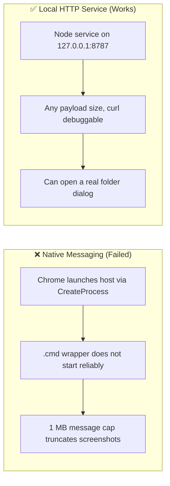
* **Code Anchors (Grep Targets):**
  * `local-service/host.js` -> `startHttp`, `dispatch`, `startStdio`
* **Note:** `--stdio` mode still exists in the service as an escape hatch if the native-host route is ever revisited.

### [DECISION: One-Clip-Object-One-Renderer] | Aliases: single model, same format, adapter boundary
> **1-Line Summary:** Adapters produce data, never Markdown; exactly one renderer turns data into a note.
* **Decision Maker:** `[DECIDED BY: AGENT - Approved by Human]`
* **Original User Intention:** Every source must produce the same note format, so the vault stays uniform however a clip arrived.
* **Options Considered:**
  * **Option A (Rejected):** Let each site adapter build its own Markdown. Tempting because Facebook and Reddit structure content so differently — and it is exactly how six sources become six incompatible note formats.
  * **Option B (Chosen):** One `Clip` shape and one `renderNote`, with adapters only filling the object. Adding a source then costs one adapter, and the format stays a single thing that can be revised in one place.
* **Visual Pivot Map (What Failed vs. What Works):**
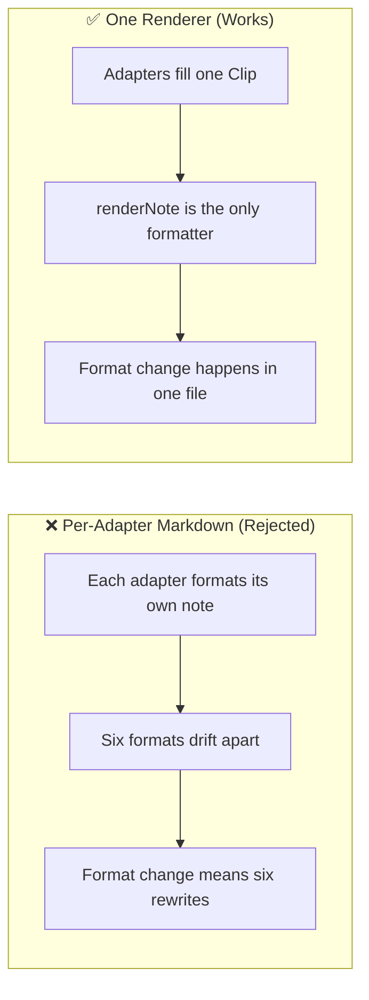
* **Code Anchors (Grep Targets):**
  * `extension/src/lib/render.js` -> `renderNote`
  * `extension/src/content/extract.js` -> `OC.extract`

### [DECISION: Image-Tokens-Resolved-Downstream] | Aliases: @@IMG:n@@, placeholders, token resolution
> **1-Line Summary:** The page-side extractor emits `@@IMG:n@@` placeholders and the privileged layer decides whether each becomes a wikilink, a relative path or a remote URL.
* **Decision Maker:** `[DECIDED BY: AGENT - Approved by Human]`
* **Original User Intention:** Images must end up in the vault, referenced the way the user's Obsidian setup expects, without the page-side code needing disk or network access.
* **Options Considered:**
  * **Option A (Rejected):** Resolve image files in the content script. It cannot reliably fetch cross-origin images and must not touch the filesystem; signed CDN URLs also expire between capture and write.
  * **Option B (Chosen):** Emit tokens plus a manifest of image URLs. The background resolves them after settings are known, and the service downloads the bytes.
* **Visual Pivot Map (What Failed vs. What Works):**
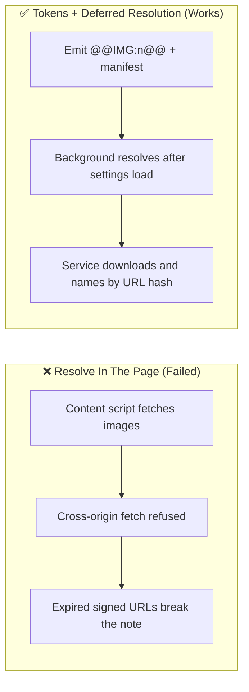
* **Code Anchors (Grep Targets):**
  * `extension/src/content/lib.js` -> `OC.stashImages`
  * `extension/src/lib/render.js` -> `resolveBodyTokens`, `assetName`

### [DECISION: Hand-Rolled-YAML-Serializer] | Aliases: yamlScalar, frontmatter corruption, quoting, reserved words
> **1-Line Summary:** Frontmatter is serialised by a small hand-written function instead of a generic YAML library.
* **Decision Maker:** `[DECIDED BY: AGENT - Approved by Human]`
* **Original User Intention:** Notes must never arrive with corrupted frontmatter, because a broken frontmatter block makes the note invisible to Dataview and Bases.
* **Options Considered:**
  * **Option A (Rejected):** A generic YAML stringifier. It pulls a dependency into a pure renderer and, more importantly, produced broken output on titles containing `:` and quotes in early trials.
  * **Option B (Chosen):** A deliberately small `yamlScalar` that quotes reserved words (`true`, `null`, `123`), escapes embedded quotes, and leaves safe slugs bare so Obsidian reads them as strings.
* **Visual Pivot Map (What Failed vs. What Works):**
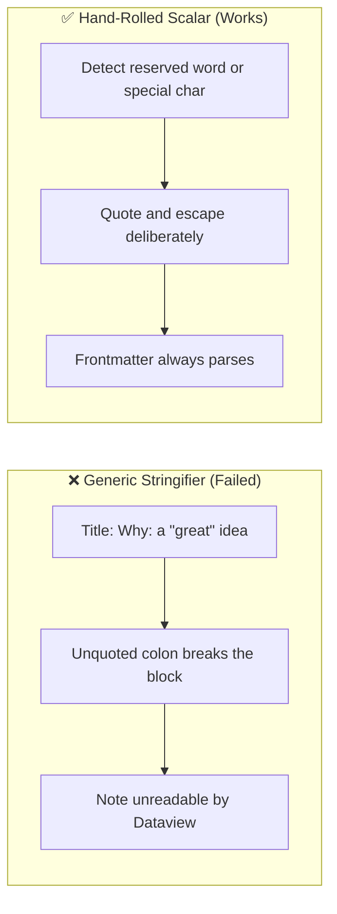
* **Code Anchors (Grep Targets):**
  * `extension/src/lib/render.js` -> `yamlScalar`

### [DECISION: Backup-Instead-Of-Overwrite] | Aliases: hand-edited note, timestamped backup, data loss
> **1-Line Summary:** If a note already exists and the owner has edited it by hand, the service writes a timestamped backup before replacing it.
* **Decision Maker:** `[DECIDED BY: AGENT - Approved by Human]`
* **Original User Intention:** Re-clipping a page must never silently destroy annotations the user added to the previous note.
* **Options Considered:**
  * **Option A (Rejected):** Silently overwrite. Simple, and quietly destructive — the exact failure a personal vault cannot tolerate.
  * **Option B (Rejected):** Merge the old and new content. Merging needs a diff policy that does not exist and would produce a Frankenstein note.
  * **Option C (Chosen):** Write a timestamped backup alongside, then write the new note.
* **Visual Pivot Map (What Failed vs. What Works):**
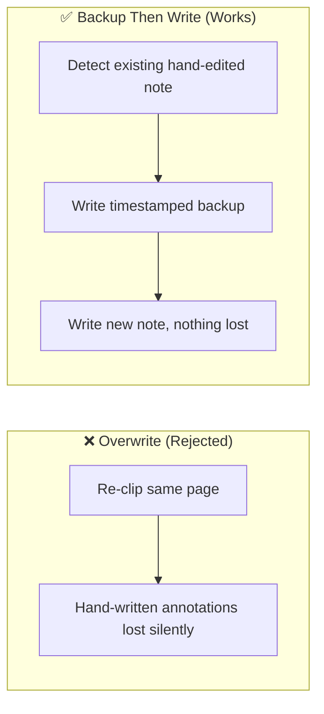
* **Code Anchors (Grep Targets):**
  * `local-service/host.js` -> `opSave`

### [DECISION: Asset-URI-As-Export-Contract] | Aliases: asset scheme, inlining, pdf images, archive images
> **1-Line Summary:** Exports reference images as `asset://name`, which the service resolves to real bytes when producing a PDF or a self-contained HTML file.
* **Decision Maker:** `[DECIDED BY: AGENT - Approved by Human]`
* **Original User Intention:** A note PDF and a portable HTML file must contain their images, not links that die when the vault moves.
* **Options Considered:**
  * **Option A (Rejected):** Each exporter resolving images its own way. Two paths, two sets of edge cases, and the HTML exporter already needed data URIs while the PDF path needed local files.
  * **Option B (Chosen):** One `asset://` scheme that both exporters emit, with the service doing the resolution once and `path.basename` guarding the name against traversal.
* **Visual Pivot Map (What Failed vs. What Works):**
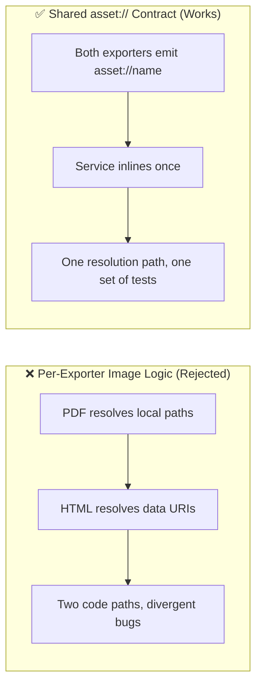
* **Code Anchors (Grep Targets):**
  * `local-service/host.js` -> `inlineAssetRefs`
  * `extension/src/background.js` -> `renderPdfHtml`, `renderArchiveHtml`

### [DECISION: Pinned-Extension-Identity] | Aliases: manifest key, extension id, deolmeei, storage
> **1-Line Summary:** The manifest carries a public key so the unpacked extension always receives the same ID.
* **Decision Maker:** `[DECIDED BY: AGENT - Approved by Human]`
* **Original User Intention:** Settings and permissions must not reset just because the folder was moved.
* **Options Considered:**
  * **Option A (Rejected):** Let the browser derive the ID from the install path. Moving or renaming the folder silently produces a new extension with empty storage and re-asks for all permissions.
  * **Option B (Chosen):** A pinned `key` in the manifest, giving the constant ID `deolmeeiaonpcokalgopkcihblojihlh` independent of location.
* **Visual Pivot Map (What Failed vs. What Works):**
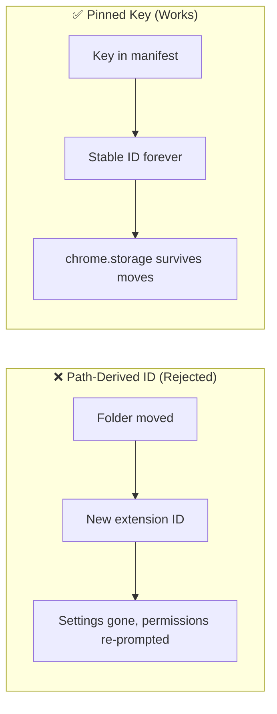
* **Code Anchors (Grep Targets):**
  * `extension/manifest.json` -> `key`
  * `tools/gen-key.js`

### [DECISION: Accessibility-Asserted-In-Markup] | Aliases: a11y-check, accessible names, live regions, keyboard
> **1-Line Summary:** Accessibility is enforced by a test that reads the markup, not by visual inspection.
* **Decision Maker:** `[DECIDED BY: AGENT - Approved by Human]`
* **Original User Intention:** The tool must be fully operable by keyboard and screen reader, and stay that way as the popup changes.
* **Options Considered:**
  * **Option A (Rejected):** Eyeball it. It caught nothing, and the popup has async status text that silently changes without a live region.
  * **Option B (Chosen):** `test/a11y-check.js` asserts accessible names, control labels, live regions, unique ids and that every id the script looks up still exists in the markup. It caught a real regression during the build (an input lost its `aria-label`).
* **Visual Pivot Map (What Failed vs. What Works):**
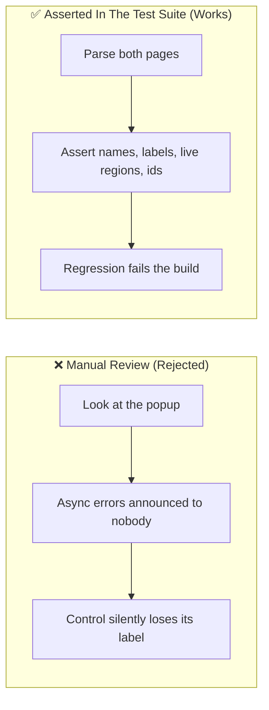
* **Code Anchors (Grep Targets):**
  * `test/a11y-check.js` -> `check`

### [DECISION: Obsidian-Note-Format-Settled-By-Owner] | Aliases: settled format, single clipping folder, quick save, no engagement
> **1-Line Summary:** The owner decided the note destination and layout on 2026-11-07: a single default folder (`Web Clipper Manager` or `Web Clipping`) with Quick Save, no engagement callouts, and 1 note per Telegram message.
* **Decision Maker:** `[DECIDED BY: HUMAN]`
* **Original User Intention:** The owner wanted the note layout and workflow settled decisively: simple filing into one configured vault folder, avoiding metric clutter, and keeping capture single-step.
* **Options Considered:**
  * **Option A (Rejected):** Multi-level subfolders per source with complex append/merge pipelines for multi-message or video formats.
  * **Option B (Chosen):** A single configured default folder in the vault (`Web Clipper Manager` or `Web Clipping`) with a Quick Save toggle or manual folder selection; Telegram as one note per message; engagement counts dropped entirely.
* **Visual Pivot Map (What Failed vs. What Works):**
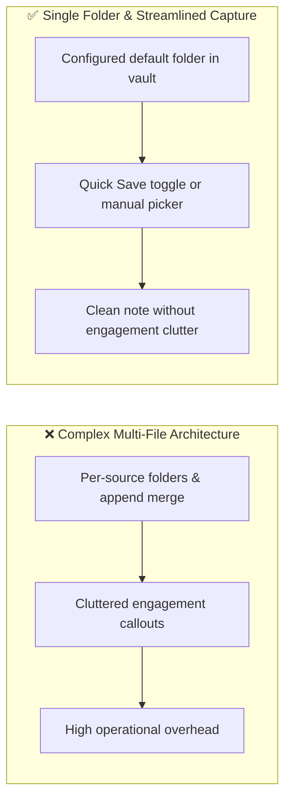
* **Code Anchors (Grep Targets):**
  * `extension/src/lib/render.js` -> `renderNote`, `buildNoteFilename`
  * `SCOPE.md` -> section "Settled Decisions (Updated 2026-11-07)"

### [DECISION: Scope-Exclusion-YouTube] | Aliases: remove youtube, youtube out of scope, native embeds
> **1-Line Summary:** YouTube is explicitly removed from scope because Obsidian already supports native video embeds and the owner maintains a separate YouTube workflow.
* **Decision Maker:** `[DECIDED BY: HUMAN]`
* **Original User Intention:** Avoid building redundant clipping infrastructure for video content when native embedding exists and separate dedicated plans are already in place.
* **Options Considered:**
  * **Option A (Rejected):** Build an elaborate YouTube extractor with transcript parsing, chapters, and duration frontmatter.
  * **Option B (Chosen):** Drop YouTube completely from the extension scope to keep the tool focused on text and visual web clipping.
* **Visual Pivot Map (What Failed vs. What Works):**
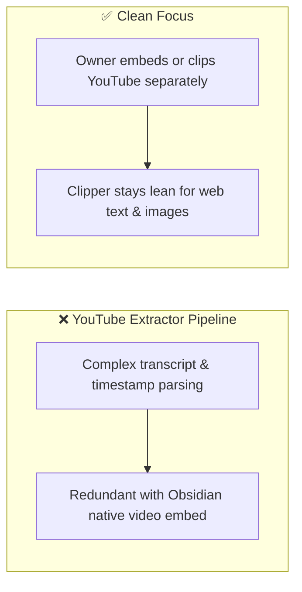
* **Code Anchors (Grep Targets):**
  * `SCOPE.md` -> section "Out of scope — do not implement: Sources removed"

### [DECISION: Telegram-One-Note-Per-Message] | Aliases: telegram note structure, single message note, t.me
> **1-Line Summary:** Telegram clips from public channels (`t.me/s/<channel>`) produce one note per message, preserving the 1-capture = 1-note pipeline.
* **Decision Maker:** `[DECIDED BY: HUMAN]`
* **Original User Intention:** Clip messages from public channels cleanly without requiring an invasive append/merge engine or complex multi-message synchronization.
* **Options Considered:**
  * **Option A (Rejected):** Append multiple messages into a single running channel note, requiring stateful note mutation and concurrency guards.
  * **Option B (Chosen):** One note per message (with future optional multi-selection), fitting naturally into the existing `Clip` object and single renderer.
* **Visual Pivot Map (What Failed vs. What Works):**
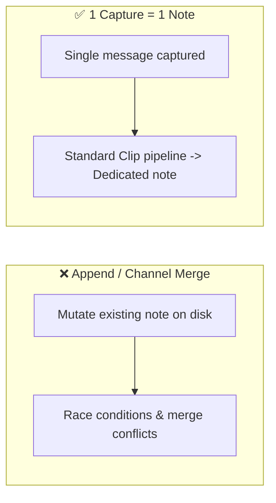
* **Code Anchors (Grep Targets):**
  * `extension/src/content/extract.js` -> `extractTelegram`
  * `SCOPE.md` -> section "Settled Decisions (Updated 2026-11-07)"

### [DECISION: Drop-Engagement-Counts] | Aliases: remove engagement, no upvotes, no likes, no reposts
> **1-Line Summary:** Engagement counts (upvotes, likes, reposts) and the `> [!quote]- Engagement at capture` callout are dropped to eliminate unnecessary complication.
* **Decision Maker:** `[DECIDED BY: HUMAN]`
* **Original User Intention:** Keep notes clean and evergreen; engagement metrics age immediately and add zero value to personal knowledge management in Obsidian.
* **Options Considered:**
  * **Option A (Rejected):** Scrape and maintain dynamic like/repost/comment metrics in callouts.
  * **Option B (Chosen):** Drop engagement callouts and frontmatter fields completely across all sources.
* **Visual Pivot Map (What Failed vs. What Works):**
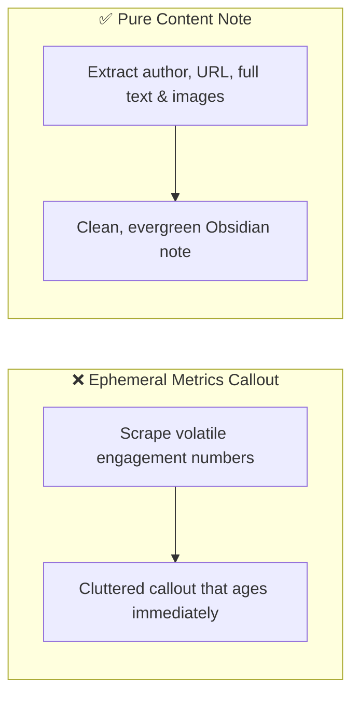
* **Code Anchors (Grep Targets):**
  * `extension/src/lib/render.js` -> `renderNote`, `engagementLine`

### [DECISION: Social-Posts-No-Comments-Policy] | Aliases: no comments facebook twitter, reddit optional comments
> **1-Line Summary:** Facebook and Twitter extract only post content (author, profile name, original URL, full text body, images) without comments; comments are optional and capped elsewhere.
* **Decision Maker:** `[DECIDED BY: HUMAN]`
* **Original User Intention:** Prevent fragile selector breakage and deep comment recursion on social networks where the owner only cares about the main post.
* **Options Considered:**
  * **Option A (Rejected):** Attempt comment scraping on Facebook and Twitter/X.
  * **Option B (Chosen):** Strictly no comments on Facebook/Twitter; Reddit comments remain optional and capped (~5-25) only if friction-free, skipped if complex.
* **Visual Pivot Map (What Failed vs. What Works):**
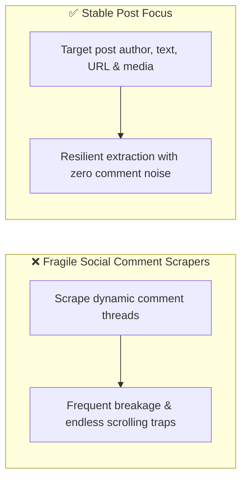
* **Code Anchors (Grep Targets):**
  * `extension/src/content/extract.js` -> `extractFacebook`, `extractTwitter`, `extractReddit`

### [DECISION: Deliberately-Narrow-Scope] | Aliases: out of scope, rejected sources, no AI, no tagging
> **1-Line Summary:** Scope is five sources, four formats and two browsers, and pruning is permanent rather than a phase.
* **Decision Maker:** `[DECIDED BY: HUMAN]`
* **Original User Intention:** The owner files, tags, searches and analyses in other tools. Anything the clipper does in those areas duplicates existing work and splits the source of truth.
* **Options Considered:**
  * **Option A (Rejected):** Add whatever is easy — YouTube, Bluesky, Mastodon, Hacker News, JSON export, a Notion target.
  * **Option B (Chosen):** A written out-of-scope list in `SCOPE.md` that a future session reads before proposing anything.
* **Visual Pivot Map (What Failed vs. What Works):**
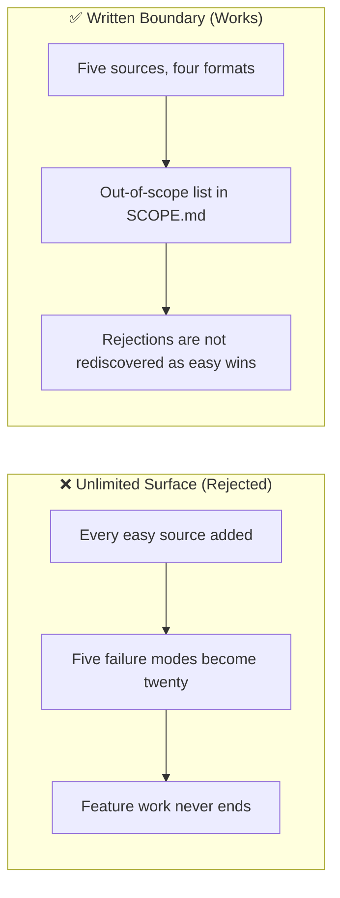
* **Code Anchors (Grep Targets):**
  * `SCOPE.md` -> section "Out of scope — do not implement"

## 2. Do-Not-Touch Engineering Landmines (Traps)

### [TRAP: Content-Script-Load-Order] | Aliases: globalThis.OC, classic scripts, manifest order, OC undefined
> **1-Line Summary:** **NEVER** reorder, lazy-load or module-ise the content scripts; `globalThis.OC` is assembled by execution order.
* **Strict Rule:** **NEVER** reorder the content script list in the manifest, and **NEVER** convert them to ES modules.
* **Why This Trap Exists (Plain English):** MV3 content scripts cannot be ES modules and there is no bundler in this project, so `lib.js` runs first and attaches `OC` helpers to the global object, then `extract.js` uses them. Reordering makes `OC` partially defined and the extension fails at capture time with an unhelpful "not a function" error, not at load time.
* **Protected Code Anchors (Grep Targets):**
  * `extension/manifest.json` -> `content_scripts`
  * `extension/src/content/lib.js` -> `OC`
  * `extension/src/content/extract.js` -> `OC.extract`

### [TRAP: Never-Leave-The-Debugger-Attached] | Aliases: debugger banner, detach, DevTools conflict
> **1-Line Summary:** **NEVER** attach the debugger without a `finally` detach; a leaked session leaves a permanent banner and blocks the next capture.
* **Strict Rule:** **NEVER** call `chrome.debugger.attach` outside `withDebugger`, and never remove the `finally` block.
* **Why This Trap Exists (Plain English):** An attached debugger shows a browser infobar, blocks attach for any other operation, and prevents DevTools from opening normally. Because attach fails when DevTools is already open, the code must fall back rather than throw.
* **Protected Code Anchors (Grep Targets):**
  * `extension/src/background.js` -> `withDebugger`, `captureFullPage`, `printPagePdf`

### [TRAP: Path-Traversal-Guards] | Aliases: assertInside, safeJoin, vault escape, dot dot
> **1-Line Summary:** **NEVER** join a caller-supplied path to the vault without `assertInside`; the guard is the only thing between a bad path and the owner's filesystem.
* **Strict Rule:** **NEVER** bypass `assertInside` or `safeJoin`, including in a new operation added for a "quick fix".
* **Why This Trap Exists (Plain English):** The service trusts requests from the extension, but a malformed or hostile note path containing `..` would otherwise write outside the vault. The guard is covered by a test, so removing it fails the suite rather than silently weakening the boundary.
* **Protected Code Anchors (Grep Targets):**
  * `local-service/host.js` -> `assertInside`, `safeJoin`, `requireVault`, `opSave`

### [TRAP: Service-Must-Bind-Loopback-Only] | Aliases: 0.0.0.0, localhost, network exposure, CORS
> **1-Line Summary:** **NEVER** bind the local service to `0.0.0.0` or relax its CORS origins; it would expose vault writes to the local network.
* **Strict Rule:** **NEVER** change the bind address away from `127.0.0.1`, and never widen the accepted origins beyond browser-extension schemes.
* **Why This Trap Exists (Plain English):** The service writes files into the vault with no authentication, because it assumes it is unreachable from the network. Binding it more widely turns an unauthenticated file-write endpoint into a network service.
* **Protected Code Anchors (Grep Targets):**
  * `local-service/host.js` -> `startHttp`

### [TRAP: Omni-Prefix-Is-Data-Not-Branding] | Aliases: omni- hash, note id, asset filename, rename risk
> **1-Line Summary:** **NEVER** rename the `omni-` prefix on note IDs or asset filenames; it is stored in every existing note and image name.
* **Strict Rule:** **NEVER** change `id: omni-<hash>` or `omni-<hash>.<ext>` while renaming the product.
* **Why This Trap Exists (Plain English):** The product was renamed to Web Clipper Manager, but the prefix also appears in thousands of already-written notes and attachment filenames. Changing it would orphan every existing attachment reference and break the "same page, same ID" promise for notes already in the vault.
* **Protected Code Anchors (Grep Targets):**
  * `extension/src/lib/render.js` -> `clipId`, `assetName`

### [TRAP: Editing-Source-Files-With-PowerShell-Defaults] | Aliases: encoding, BOM, mojibake, Set-Content, em dash
> **1-Line Summary:** **NEVER** rewrite these source files with `Set-Content` or `Out-File` defaults; Windows PowerShell decodes UTF-8 as ANSI and corrupts em dashes and arrows.
* **Strict Rule:** **NEVER** bulk-edit `.js`, `.html` or `.md` source files with a PowerShell read/write round trip unless it explicitly specifies UTF-8 without BOM. Use the `edit`/`write` tools.
* **Why This Trap Exists (Plain English):** A rename pass through `Get-Content`/`Set-Content` turned `—` into `â€"` and `→` into `â†'` inside `local-service/host.js`, and added a UTF-8 BOM that a non-encoded read will surface as an invisible character at the start of the file. The files still parse, so the damage is invisible until a console message or a UI string renders as garbage. It happened once while renaming for this repository.
* **Protected Code Anchors (Grep Targets):**
  * `local-service/host.js`
  * `extension/src/content/lib.js`, `extension/src/content/extract.js`

### [TRAP: Adapters-Must-Not-Emit-Markdown] | Aliases: formatting in extractor, drift, one renderer
> **1-Line Summary:** **NEVER** let a source adapter build note text; it must return data and leave every formatting decision to `renderNote`.
* **Strict Rule:** **NEVER** add frontmatter, callouts, filename logic or Obsidian syntax inside `extension/src/content/extract.js`.
* **Why This Trap Exists (Plain English):** The moment one adapter formats its own output, "the same format for every source" stops being true, and every future format change becomes a hunt through four adapters instead of one function.
* **Protected Code Anchors (Grep Targets):**
  * `extension/src/content/extract.js` -> `extractArticle`, `extractFacebook`, `extractTwitter`, `extractReddit`
  * `extension/src/lib/render.js` -> `renderNote`

### [TRAP: Renderer-Follows-Owner-Decisions] | Aliases: format rules, do not redesign, single clipping folder, drop engagement
> **1-Line Summary:** **NEVER** re-introduce engagement callouts, multi-level source subfolders, or YouTube adapters against the owner's settled decisions.
* **Strict Rule:** **NEVER** add unsolicited format "enhancements" or complex per-source directory hierarchies. The note destination is a single configured vault folder (`Web Clipper Manager` / `Web Clipping`), Quick Save or manual selection, engagement callouts are dropped, and Telegram is 1 note per message.
* **Why This Trap Exists (Plain English):** The owner explicitly settled these format questions on 2026-11-07 to keep personal knowledge management simple, fast, and free of noisy metrics. Improvised changes violate user intention and clutter the vault.
* **Protected Code Anchors (Grep Targets):**
  * `extension/src/lib/render.js` -> `renderNote`, `buildNoteFilename`, `attachmentDir`
  * `SCOPE.md` -> section "Settled Decisions (Updated 2026-11-07)"

### [TRAP: Rejected-Features-Are-Not-Easy-Wins] | Aliases: youtube, bluesky, mastodon, notion, json export, scope creep
> **1-Line Summary:** **NEVER** re-propose YouTube, Bluesky, Mastodon, Hacker News, Notion, Logseq, Joplin, JSON/CSV export, Safari, Firefox or the automation layer.
* **Strict Rule:** **NEVER** add a source, format, destination or browser that `SCOPE.md` lists as out of scope. If one genuinely seems necessary, ask first — do not add it and mention it afterwards.
* **Why This Trap Exists (Plain English):** Several of those were agent suggestions that the owner considered and explicitly rejected (including YouTube, which is handled via native embeds and separate workflows). They look like quick wins and are not: each one adds a permanent failure mode to a tool whose value is that it is small and finished.
* **Protected Code Anchors (Grep Targets):**
  * `SCOPE.md` -> section "Out of scope — do not implement"
  * `docs/PRODUCT.md` -> section "Deliberately Removed"

### [TRAP: Facebook-Extraction-Is-Heuristic] | Aliases: facebook breaks, internal class names, gallery order
> **1-Line Summary:** **NEVER** rewrite Facebook extraction to depend on generated class names; it scores structural candidates on purpose and still needs periodic maintenance.
* **Strict Rule:** **NEVER** target obfuscated Facebook class names or `data-*` ids that change per session. Keep scoring on `[role=article]` structure.
* **Why This Trap Exists (Plain English):** Facebook randomises class names, A/B tests layouts and serves expiring signed image URLs. The current adapter scores candidate containers and picks the deepest text block precisely so that a class-name change does not break it. It will still need maintenance every few months; that is expected, not a bug to be engineered away.
* **Protected Code Anchors (Grep Targets):**
  * `extension/src/content/extract.js` -> `scoreFacebookArticle`, `pickFacebookArticle`, `extractFacebook`

### [TRAP: Storage-Key-Rename-Breaks-Settings] | Aliases: settings keys, chrome.storage, defaults mismatch
> **1-Line Summary:** **NEVER** rename a settings key in `DEFAULTS` without a migration; every user's saved configuration is keyed by those exact names.
* **Strict Rule:** **NEVER** rename an existing key in `DEFAULTS`; add a new key or migrate the old value.
* **Why This Trap Exists (Plain English):** Settings live in `chrome.storage.sync` under these literal names. Renaming a key does not rename stored data — it silently falls back to the default value, so the owner's vault path and folder configuration appear to vanish.
* **Protected Code Anchors (Grep Targets):**
  * `extension/src/lib/settings.js` -> `DEFAULTS`, `getSettings`, `setSettings`
