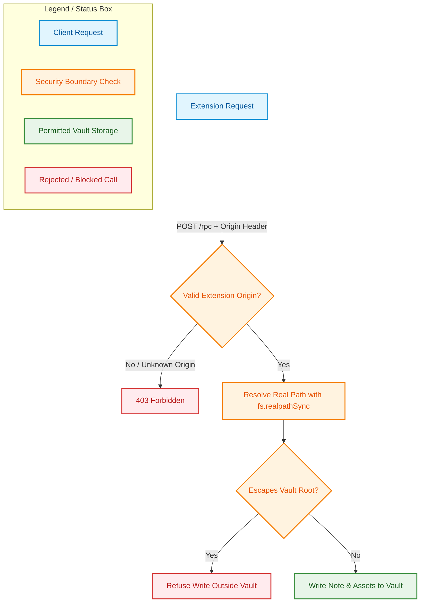
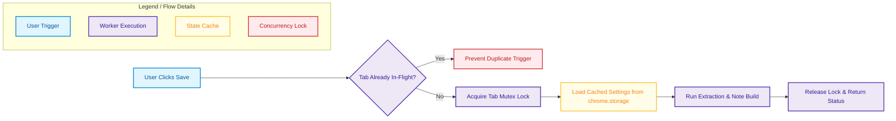
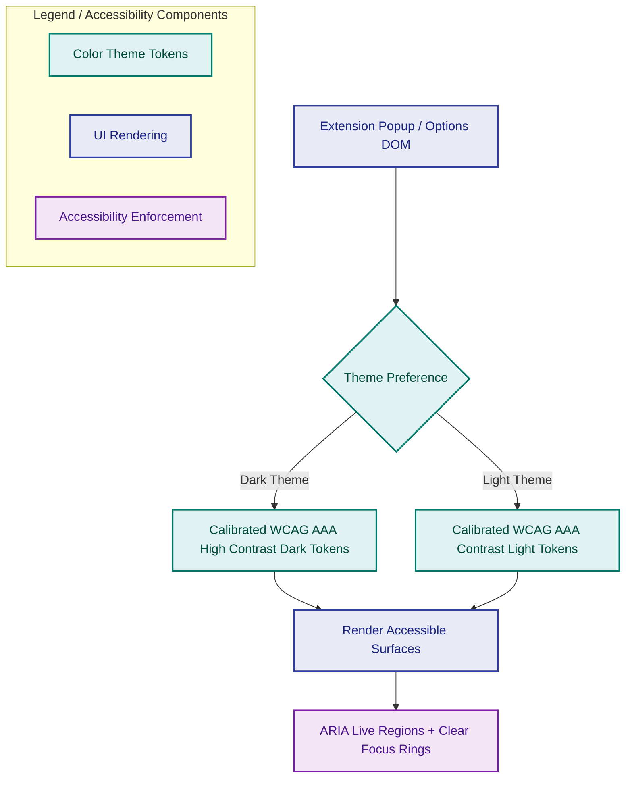
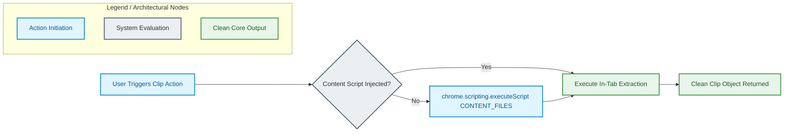
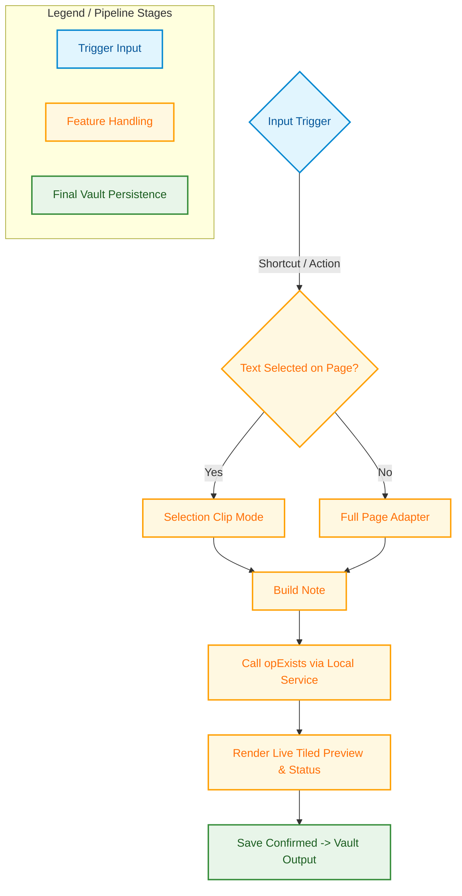

# Visual Feature & Commit Log (`VISUAL_LOG.md`)
> **1-Line Summary:** Visual Obsidian-compatible Mermaid flowcharts and plain-English architectural breakdowns for features and system revisions.

## 1. Feature & Milestone Progression

### [LOG: Phase-1-Security-Hardening] | Aliases: security hardening, origin pinning, symlink guard, ssrf, xss
> **1-Line Summary:** Locks down the local loopback service and browser extension against symlink escapes, unauthorized origins, and SSRF.

* **Plain-English Explanation:** The local HTTP service now requires explicit origin pinning (matching `chrome-extension://` IDs) and uses `fs.realpathSync` to ensure note and asset writes cannot climb outside the Obsidian vault via directory symlinks or junctions. Remote image downloads validate target addresses to block SSRF into loopback or internal metadata IP ranges, and PowerShell directory selection arguments are strictly validated.

---

### [LOG: Phase-2-Core-Bugs-And-Concurrency] | Aliases: concurrency locks, mv3 state, caching, turndown
> **1-Line Summary:** Solves MV3 background worker eviction races, enforces in-flight concurrency locks, and fixes extractor edge cases.

* **Plain-English Explanation:** Manifest V3 background service workers can shut down at any time. State is now persisted across worker lifecycles, and concurrent save/export operations for the same active tab are locked to prevent duplicate writes or collisions. Extractor edge cases in Turndown HTML parsing and image stashing are cleanly resolved.

---

### [LOG: Phase-3-UI-Accessibility-And-Contrast] | Aliases: wcag contrast, options layout, responsive popup, a11y
> **1-Line Summary:** Polishes user interface contrast across themes and optimizes options and popup layouts for accessibility.

* **Plain-English Explanation:** Options and popup pages are overhauled to guarantee WCAG AA/AAA contrast ratios in both Light and Dark modes. Keyboard focus indicators, form control labels, and ARIA live regions ensure fully accessible screen-reader navigation and status updates.

---

### [LOG: Phase-4-Scope-Parity-And-Dead-Code-Pruning] | Aliases: scope parity, dead code pruning, on-demand injection
> **1-Line Summary:** Prunes legacy unused scripts and switches content scripts to on-demand programmatic injection.

* **Plain-English Explanation:** Dead vendor code (`readability-readerable.js`) and dropped features are removed. Instead of permanently injecting content scripts into every open tab in the browser on startup, scripts are injected programmatically on-demand only when a clip is requested on the active tab.

---

### [LOG: Phase-5-QoL-And-Lateral-Features] | Aliases: shortcuts, side panel, dup check, preview tiling, selection clip
> **1-Line Summary:** Adds keyboard shortcuts, side panel reader mode, live Markdown preview tiling, duplicate note warnings, and selection clipping.

* **Plain-English Explanation:** Users can now clip highlighted text directly without saving the whole page, check the vault via `opExists` for existing notes to avoid unexpected overwrites, view live Markdown previews side-by-side in a persistent side panel, and trigger actions with keyboard shortcuts.

